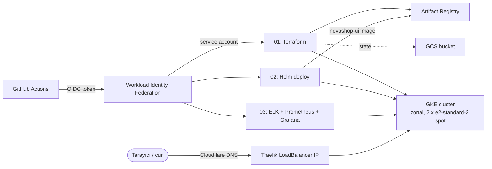

# LAB-12 — GKE, Terraform ve GitHub Actions ile NovaShop

## Amaç

NovaShop'u Google Cloud üzerinde çalıştırmak. Altyapı (VPC, GKE cluster, Artifact Registry) Terraform ile **yalnızca GitHub Actions içinden** kurulur ve silinir; uygulama Helm ile, monitoring/logging araçları kubectl ile yine Actions üzerinden dağıtılır. Actions GCP'ye anahtar dosyası olmadan, **Workload Identity Federation (WIF)** ile bağlanır.

Akış dört workflow'dan oluşur; sırayla çalıştırılır:

| Workflow | Dosya | Ne yapar |
|---|---|---|
| `LAB-12 - 00 GCP Hazırlık (Bootstrap)` | `.github/workflows/lab12-bootstrap.yml` | `apply`: API'ler, state bucket'ı, service account, WIF; sonuçları GitHub secret'larına yazar. `destroy`: bunları siler |
| `LAB-12 - 01 GKE Altyapısı (Terraform)` | `.github/workflows/lab12-infra.yml` | `plan` / `apply` / `destroy`: VPC, GKE, Artifact Registry ve Traefik ingress controller |
| `LAB-12 - 02 NovaShop GKE Uygulama Dağıtımı` | `.github/workflows/lab12-deploy.yml` | UI testleri, image build, Artifact Registry'ye push, Helm ile 5 mikroservis, smoke test |
| `LAB-12 - 03 GKE Monitoring & Logging Dağıtımı` | `.github/workflows/lab12-monitoring.yml` | ELK 9, Prometheus, Grafana, ortak Ingress, Cloudflare DNS |

## Ön Koşullar

- Billing açık bir GCP projesi ve bu projede `Owner` yetkisi.
- Bu reponun kendi GitHub hesabınızdaki kopyası (fork) ve repoda Settings erişimi.
- Yerelde `gcloud` CLI (yalnızca bootstrap token'ı almak ve lokal bağlantı için) ve `kubectl`.
- İsteğe bağlı: alan adı Cloudflare'de olan bir zone (DNS kayıtları için).

## Mimari ve Çalışma Modeli



- **00 Bootstrap** bir kere çalışır: API'leri açar, Terraform state bucket'ını, GitHub Actions service account'unu ve WIF'i oluşturur, bulduğu değerleri `gh` ile repoya secret/variable olarak yazar. Bu adım sizin GCP kimliğinizle (`GCP_BOOTSTRAP_CREDENTIALS`) çalışır; sonraki workflow'lar anahtarsız WIF kullanır.
- **01, 02, 03** altyapıyı, uygulamayı ve monitoring'i kurar. İş bitince **01 destroy** altyapıyı, isterseniz **00 destroy** hazırlık kaynaklarını siler.

<details>
<summary><strong>Dizin yapısı</strong></summary>

```text
labs/LAB-12/
├── terraform/
│   ├── versions.tf            # google provider, GCS backend
│   ├── variables.tf           # proje, bölge, zone, node tipi/sayısı
│   ├── main.tf                # modül çağrıları
│   ├── outputs.tf             # cluster adı, Artifact Registry adresi
│   └── modules/
│       ├── network/           # VPC + subnet (pod ve service IP aralıkları)
│       ├── gke/               # zonal cluster + spot node pool + node service account
│       └── artifact-registry/ # Docker reposu
├── helm/values-gke.yaml       # charts/novashop için GKE değerleri (Traefik Ingress)
└── monitoring/                # 00-06 ELK, Prometheus, Grafana; 07 Traefik Ingress
```

</details>

<details>
<summary><strong>Terraform modülleri ne yapıyor</strong></summary>

**`versions.tf`**: State dosyası runner'da değil, hazırlıkta açılan GCS bucket'ında durur. Bucket adı workflow'da `-backend-config` ile verilir:

```hcl
backend "gcs" {}
```

**`modules/network`**: Otomatik subnet'siz bir VPC ve tek subnet açar. GKE VPC-native çalıştığı için pod ve service IP'leri subnet'in ikincil aralıklarından gelir:

```hcl
secondary_ip_range {
  range_name    = "pods"
  ip_cidr_range = var.pods_cidr
}
```

**`modules/gke`**: Zonal (tek zone) cluster açar; varsayılan node pool yerine ayrı, yönetilebilir bir node pool kullanır. Node'lar spot (ucuz, kesintiye uğrayabilir) ve en az yetkili ayrı bir service account ile çalışır:

```hcl
resource "google_container_cluster" "this" {
  location            = var.zone
  initial_node_count  = 0
  deletion_protection = false
  ...
}

resource "google_container_node_pool" "default" {
  node_count = var.node_count
  node_config {
    machine_type    = var.machine_type
    spot            = var.spot
    service_account = google_service_account.nodes.email
  }
}
```

**`modules/artifact-registry`**: UI image'ının gönderileceği Docker reposu (`<BÖLGE>-docker.pkg.dev/<PROJE_ID>/novashop`).

</details>

## Adım Adım Uygulama Rehberi

### 1. GitHub'a girilecek secret ve variable'lar

Reponuzda **Settings > Secrets and variables > Actions** sayfasında girilir. Secret'lar **Secrets** sekmesinde **New repository secret** ile, variable'lar **Variables** sekmesinde **New repository variable** ile eklenir. Secret'lar loglarda maskelenir, variable'lar düz metindir.

#### 1.1 Sizin girmeniz zorunlu olanlar

| Tür | Ad | Ne | Nasıl alınır | Örnek |
|---|---|---|---|---|
| Secret | `GCP_BOOTSTRAP_CREDENTIALS` | Bootstrap'in GCP'ye bağlanması için kimlik dosyası. İçindeki refresh token ile her koşuda yeni token alınır; süresi dolmaz, iptal edilene kadar geçerlidir | Yerelde `gcloud auth application-default login`, ardından `~/.config/gcloud/application_default_credentials.json` dosyasının tüm içeriği | `{"client_id": "....apps.googleusercontent.com", "client_secret": "...", "refresh_token": "1//0...", "type": "authorized_user"}` |
| Secret | `GH_PAT` | Bootstrap'in sonuçları repoya secret/variable olarak yazabilmesi için GitHub token'ı | GitHub > Settings > Developer settings > Personal access tokens > Fine-grained tokens > Generate new token. Repository access: bu repo. Permissions: **Secrets** ve **Variables** = Read and write | `github_pat_11A...` |
| Variable (veya Secret) | `GCP_PROJECT_ID` | GCP proje ID'si; secret olarak girilirse loglarda maskelenir | Console'da üstteki proje seçici > ID sütunu | `my-project-123456` |

#### 1.2 İsteğe bağlı olanlar

Girilmezse varsayılan değer kullanılır; Cloudflare secret'ları yoksa DNS adımı uyarıyla atlanır ve uygulamaya IP üzerinden erişilir.

| Tür | Ad | Ne | Varsayılan / örnek |
|---|---|---|---|
| Variable | `GCP_REGION` | Subnet ve Artifact Registry bölgesi | `europe-west1` |
| Variable | `GCP_ZONE` | Zonal GKE cluster'ın zone'u | `europe-west1-b` |
| Variable | `GKE_CLUSTER_NAME` | GKE cluster adı | `novashop-training-gke` |
| Variable | `BASE_DOMAIN` | Uygulama ve monitoring alan adları için kök domain | `devopsatolyesi.com` |
| Secret | `CLOUDFLARE_API_TOKEN` | DNS kayıtları için Cloudflare token'ı. Cloudflare > My Profile > API Tokens > Create Token > "Edit zone DNS" şablonu > Zone Resources: alan adınız | `Xy12...` |
| Secret | `CLOUDFLARE_ZONE_ID` | Alan adının zone ID'si. Cloudflare > alan adınız > Overview > sağ sütundaki API bölümü > Zone ID | `0f1e2d3c...` |

#### 1.3 Bootstrap'in girdikleri (elle girmeyin)

| Tür | Ad | Ne |
|---|---|---|
| Secret | `GCP_WORKLOAD_IDENTITY_PROVIDER` | WIF provider'ının tam adı |
| Secret | `GCP_SERVICE_ACCOUNT` | GitHub Actions service account'unun e-postası |
| Variable | `TF_STATE_BUCKET` | Terraform state bucket'ı (`<PROJE_ID>-tfstate`) |

Aynı değerleri `gh` CLI ile de girebilirsiniz. Komutları çalıştıracağınız terminalde repo adını tanımlayın; sonraki tüm `gh` komutları bu değişkeni kullanır:

```bash
REPO=<GITHUB_KULLANICI>/<REPO>
```

**`GCP_BOOTSTRAP_CREDENTIALS`**: Bootstrap'in GCP'ye bağlanacağı kimlik dosyasını oluşturun. Komut tarayıcıyı açar; projede Owner yetkisi olan hesapla giriş yapın:

```bash
gcloud auth application-default login
```

*Beklenen çıktı:*

```text
Credentials saved to file: [/Users/<KULLANICI>/.config/gcloud/application_default_credentials.json]

These credentials will be used by any library that requests Application Default Credentials (ADC).
```

Oluşan dosyanın içeriğini secret olarak GitHub'a gönderin (içerik ekrana yazılmaz):

```bash
gh secret set GCP_BOOTSTRAP_CREDENTIALS -R "$REPO" < ~/.config/gcloud/application_default_credentials.json
```

*Beklenen çıktı:* `✓ Set Actions secret GCP_BOOTSTRAP_CREDENTIALS for <GITHUB_KULLANICI>/<REPO>`

Arayüzden girmek isterseniz dosya içeriğini panoya kopyalayın (macOS) ve **Secrets** sekmesinde **New repository secret** ile `GCP_BOOTSTRAP_CREDENTIALS` adıyla yapıştırın:

```bash
pbcopy < ~/.config/gcloud/application_default_credentials.json
```

GitHub token'ını girin (komut değeri sorar, yapıştırıp Enter'a basın):

```bash
gh secret set GH_PAT -R "$REPO"
```

Cloudflare kullanacaksanız token ve zone ID'yi girin:

```bash
gh secret set CLOUDFLARE_API_TOKEN -R "$REPO"
gh secret set CLOUDFLARE_ZONE_ID -R "$REPO"
```

Proje ID'sini girin:

```bash
gh variable set GCP_PROJECT_ID -R "$REPO" --body "<PROJE_ID>"
```

İsteğe bağlı variable'ları varsayılandan farklı kullanacaksanız girin:

```bash
gh variable set GCP_REGION       -R "$REPO" --body "europe-west1"
gh variable set GCP_ZONE         -R "$REPO" --body "europe-west1-b"
gh variable set GKE_CLUSTER_NAME -R "$REPO" --body "novashop-training-gke"
gh variable set BASE_DOMAIN      -R "$REPO" --body "devopsatolyesi.com"
```

### 2. GCP hazırlığı: 00 Bootstrap

**Actions > LAB-12 - 00 GCP Hazırlık (Bootstrap) > Run workflow** ile `action: apply` seçin ya da:

```bash
gh workflow run lab12-bootstrap.yml -R "$REPO" -f action=apply
```

Koşuyu takip edin (yaklaşık 5 dakika; son adım yeni IAM yetkilerinin yayılması için 3 dakika bekler); yeşil bitmelidir:

```bash
gh run watch -R "$REPO" $(gh run list -R "$REPO" -w lab12-bootstrap.yml -L 1 --json databaseId --jq '.[0].databaseId')
```

Bootstrap'in yazdığı secret ve variable'ları kontrol edin (değerler gösterilmez):

```bash
gh secret list -R "$REPO" && gh variable list -R "$REPO"
```

*Beklenen:* listede `GCP_WORKLOAD_IDENTITY_PROVIDER`, `GCP_SERVICE_ACCOUNT` ve `TF_STATE_BUCKET` görünür.

<details>
<summary><strong>00 workflow'unun adımları</strong></summary>

| Adım | Ne yapar |
|---|---|
| Ön tanımları kontrol et ve GCP token'ı al | `GCP_PROJECT_ID`, `GCP_BOOTSTRAP_CREDENTIALS`, `GH_PAT` tanımlı mı bakar; refresh token ile yeni access token alıp gcloud'a verir |
| GCP erişimini doğrula | Token geçerli mi, projeye erişiliyor mu kontrol eder |
| API'leri aç | compute, container, artifactregistry, iam, iamcredentials, sts, cloudresourcemanager, storage |
| Terraform state bucket'ı | `<PROJE_ID>-tfstate` bucket'ı (versioning açık, public erişim kapalı) |
| Service account ve roller | `novashop-github` service account'u ve aşağıdaki roller |
| Workload Identity pool ve provider | `github-pool` ve GitHub OIDC provider'ı; yalnızca bu reponun token'larını kabul eder |
| IAM yetkilerinin yayılmasını bekle | Yeni rol bağlarının Google tarafında etkinleşmesi için 3 dakika bekler |
| Sonuçları GitHub'a yaz | `gh secret set` / `gh variable set` ile üç değeri repoya yazar |

| Rol | Neden |
|---|---|
| `roles/container.admin` | GKE cluster'ı kurmak/silmek, Helm ve kubectl ile dağıtım |
| `roles/compute.networkAdmin` | VPC ve subnet |
| `roles/artifactregistry.admin` | Docker reposunu kurmak, image push etmek |
| `roles/iam.serviceAccountAdmin` | Node'lar için ayrı service account oluşturmak |
| `roles/iam.serviceAccountUser` | Node pool'a bu service account'u atamak |
| `roles/resourcemanager.projectIamAdmin` | Node service account'una log/metrik/image okuma rolleri vermek |
| `roles/storage.objectAdmin` (yalnızca state bucket'ında) | Terraform state'ini okuyup yazmak |

GitHub OIDC provider'ı (kritik kısım `--attribute-condition`):

```bash
gcloud iam workload-identity-pools providers create-oidc "$PROVIDER_ID" \
  --location=global --workload-identity-pool="$POOL_ID" \
  --issuer-uri="https://token.actions.githubusercontent.com" \
  --attribute-mapping="google.subject=assertion.sub,attribute.repository=assertion.repository" \
  --attribute-condition="assertion.repository == '${REPO}'"
```

</details>

### 3. Altyapıyı kurma: 01 apply

GitHub'da **Actions > LAB-12 - 01 GKE Altyapısı (Terraform) > Run workflow** ile `action: apply` seçin ya da:

```bash
gh workflow run lab12-infra.yml -R "$REPO" -f action=apply
```

Koşuyu takip edin (ilk kurulum yaklaşık 10-12 dakika):

```bash
gh run watch -R "$REPO" $(gh run list -R "$REPO" -w lab12-infra.yml -L 1 --json databaseId --jq '.[0].databaseId')
```

<details>
<summary><strong>01 workflow'unun adımları</strong></summary>

| Adım | Ne yapar |
|---|---|
| GCP kimlik doğrulaması | GitHub OIDC token'ını WIF ile kısa ömürlü service account kimliğine çevirir |
| Terraform başlat | `terraform init -backend-config="bucket=..." -backend-config="prefix=novashop/lab-12"` |
| Biçim ve doğrulama | `terraform fmt -check` ve `terraform validate` |
| Terraform plan / apply | Plan her seçenekte çalışır; `apply` seçilirse uygulanır |
| GKE kubeconfig oluştur | `gcloud container clusters get-credentials` |
| Traefik ingress controller kur | Tek bir LoadBalancer IP'si açar; uygulama ve monitoring Ingress'leri bunu paylaşır |
| Traefik load balancer'ını kaldır | Yalnızca `destroy`: Terraform dışındaki load balancer'ı siler ki VPC silinebilsin |
| Terraform destroy | Yalnızca `destroy`: tüm altyapıyı siler |

Kimlik doğrulama bloğu (anahtar dosyası yok):

```yaml
- uses: google-github-actions/auth@v3
  with:
    project_id: ${{ vars.GCP_PROJECT_ID }}
    workload_identity_provider: ${{ secrets.GCP_WORKLOAD_IDENTITY_PROVIDER }}
    service_account: ${{ secrets.GCP_SERVICE_ACCOUNT }}
```

</details>

### 4. Uygulamayı dağıtma: 02

**Actions > LAB-12 - 02 NovaShop GKE Uygulama Dağıtımı > Run workflow** ya da:

```bash
gh workflow run lab12-deploy.yml -R "$REPO"
```

Koşuyu takip edin (yaklaşık 6-8 dakika):

```bash
gh run watch -R "$REPO" $(gh run list -R "$REPO" -w lab12-deploy.yml -L 1 --json databaseId --jq '.[0].databaseId')
```

<details>
<summary><strong>02 workflow'unun adımları</strong></summary>

| Adım | Ne yapar |
|---|---|
| Birim testleri | `src/ui` için `./mvnw test` |
| Artifact Registry girişi | `gcloud auth configure-docker <BÖLGE>-docker.pkg.dev` |
| UI image derle ve gönder | `novashop-ui:sha-<commit>` image'ını Artifact Registry'ye push eder |
| Traefik kontrol et / kur | Traefik yoksa kurar |
| Helm ile dağıt | `charts/novashop` + `labs/LAB-12/helm/values-gke.yaml`; ui, catalog, cart, orders, checkout |
| Smoke test | Ingress IP'sine `Host: novashop1.<BASE_DOMAIN>` başlığıyla `/actuator/health` ve ana sayfa isteği |

Helm komutu:

```bash
helm upgrade --install novashop charts/novashop \
  --namespace novashop --create-namespace \
  --values labs/LAB-12/helm/values-gke.yaml \
  --set ingress.hosts[0].host="$APP_HOST" \
  --set ui.image.repository="${GCP_REGION}-docker.pkg.dev/${GCP_PROJECT_ID}/${GAR_REPOSITORY}/${IMAGE_NAME}" \
  --set ui.image.tag="$IMAGE_TAG" \
  --wait --timeout 10m
```

</details>

### 5. Monitoring ve logging: 03

**Actions > LAB-12 - 03 GKE Monitoring & Logging Dağıtımı > Run workflow** ile `action: apply` ya da:

```bash
gh workflow run lab12-monitoring.yml -R "$REPO" -f action=apply
```

Koşuyu takip edin (yaklaşık 5 dakika):

```bash
gh run watch -R "$REPO" $(gh run list -R "$REPO" -w lab12-monitoring.yml -L 1 --json databaseId --jq '.[0].databaseId')
```

<details>
<summary><strong>03 workflow'unun adımları</strong></summary>

| Adım | Ne yapar |
|---|---|
| Bileşenleri kur | `labs/LAB-12/monitoring/00-07`: Elasticsearch, Kibana, Logstash, Fluent Bit, Prometheus, Grafana ve ortak Ingress |
| Kibana Data View | `k8s-logs-*` veri görünümünü oluşturur |
| Load balancer IP adresini bekle | Traefik servisinin dış IP'sini alır |
| Cloudflare DNS | `novashop1`, `elk1`, `grafana1`, `prometheus1` için proxied A kaydı açar/günceller; secret yoksa uyarıyla atlar |
| Smoke test | Her host'a load balancer IP'si üzerinden istek atar |

</details>

### 6. Doğrulama

Workflow özetindeki (Summary) load balancer IP'sini alın ve uygulamayı `Host` başlığıyla sorgulayın:

```bash
curl -s -H "Host: novashop1.devopsatolyesi.com" http://<LB_IP>/actuator/health
```

*Beklenen çıktı:* `{"status":"UP","groups":["liveness","readiness"]}`

Cloudflare secret'ları girildiyse alan adı üzerinden:

```bash
curl -s https://novashop1.devopsatolyesi.com/actuator/health
```

| Servis | Adres | Kullanıcı / Şifre |
|---|---|---|
| NovaShop | `https://novashop1.<BASE_DOMAIN>` | - |
| Grafana | `https://grafana1.<BASE_DOMAIN>` | `admin` / `devops2026` |
| Kibana | `https://elk1.<BASE_DOMAIN>` | - |
| Prometheus | `https://prometheus1.<BASE_DOMAIN>` | - |

### 7. Lokalden GKE'ye bağlanma

`gcloud` kurulu değilse kurun (macOS):

```bash
brew install --cask google-cloud-sdk
```

Diğer işletim sistemleri için: https://cloud.google.com/sdk/docs/install

GCP hesabınızla giriş yapın ve projeyi seçin:

```bash
gcloud auth login
gcloud config set project <PROJE_ID>
```

`kubectl`'in GKE'ye kimlik doğrulaması için gereken eklentiyi kurun:

```bash
gcloud components install gke-gcloud-auth-plugin kubectl
```

Cluster bilgilerini `~/.kube/config`'e yazın:

```bash
gcloud container clusters get-credentials novashop-training-gke --zone europe-west1-b
```

*Beklenen çıktı:* `kubeconfig entry generated for novashop-training-gke.`

Node'ları listeleyin; iki node `Ready` olmalıdır:

```bash
kubectl get nodes
```

Uygulama ve monitoring pod'larını listeleyin; hepsi `Running` olmalıdır:

```bash
kubectl get pods -n novashop
kubectl get pods -n logging
kubectl get pods -n monitoring
```

Load balancer IP'sini alın ve uygulamaya erişin:

```bash
LB_IP=$(kubectl get svc traefik -n traefik -o jsonpath='{.status.loadBalancer.ingress[0].ip}')
curl -s -H "Host: novashop1.devopsatolyesi.com" "http://${LB_IP}/actuator/health"
```

DNS olmadan tarayıcıdan açmak için uygulamayı lokal porta yönlendirin ve http://localhost:8080 adresini açın:

```bash
kubectl port-forward -n novashop svc/novashop-ui 8080:8080
```

## Temizlik

Altyapıyı workflow ile silin: **Actions > LAB-12 - 01 GKE Altyapısı (Terraform) > Run workflow** ile `action: destroy` ya da:

```bash
gh workflow run lab12-infra.yml -R "$REPO" -f action=destroy
```

Koşunun yeşil bittiğini kontrol edin (yaklaşık 8-10 dakika); cluster listesi boş dönmelidir:

```bash
gh run watch -R "$REPO" $(gh run list -R "$REPO" -w lab12-infra.yml -L 1 --json databaseId --jq '.[0].databaseId')
gcloud container clusters list
```

Lab'ı tamamen bitirdiyseniz hazırlık kaynaklarını (service account, WIF pool, state bucket ve bootstrap'in yazdığı secret'lar) da silin:

```bash
gh workflow run lab12-bootstrap.yml -R "$REPO" -f action=destroy
```

Son olarak bootstrap kimliğini GitHub'dan silin ve Google tarafında iptal edin:

```bash
gh secret delete GCP_BOOTSTRAP_CREDENTIALS -R "$REPO"
gcloud auth application-default revoke
```

Silinen WIF pool'u 30 gün boyunca `DELETED` durumunda kalır; bu süre içinde bootstrap tekrar çalıştırılırsa pool geri alınarak kullanılır.
