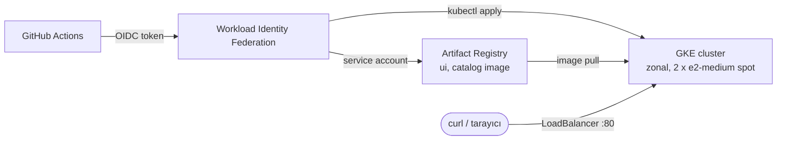

# LAB-12 — Terraform ile GKE, GitHub Actions ile Deploy

### Amaç

NovaShop altyapısını Google Cloud üzerinde Terraform ile kurmak (VPC, GKE cluster, Artifact Registry, Workload Identity Federation) ve GitHub Actions pipeline'ı ile `ui` ve `catalog` image'larını derleyip GKE'ye deploy etmek. Pipeline GCP'ye uzun ömürlü anahtar yerine GitHub OIDC token'ı ile bağlanır.

---

### Mimari



---

### Dizin yapısı

```text
labs/LAB-12/
├── terraform/
│   ├── versions.tf               # provider'lar ve GCS backend
│   ├── main.tf                   # API'ler ve modül çağrıları
│   ├── variables.tf / outputs.tf
│   ├── terraform.tfvars.example
│   └── modules/
│       ├── network/              # VPC + subnet (pod ve service aralıkları)
│       ├── gke/                  # zonal cluster + node pool + node service account
│       ├── artifact-registry/    # Docker reposu
│       └── iam-wif/              # Workload Identity pool, provider, deployer service account
└── k8s/                          # namespace, catalog ve ui manifestleri
.github/workflows/lab12-gke.yml   # build → push → deploy → smoke test
```

---

### Ön koşullar

- Billing açık bir GCP projesi ve bu projede `Owner` (veya eşdeğer) yetki.
- Bu reponun kendi GitHub hesabınızdaki kopyası (fork) ve repoda Settings erişimi.
- Yerelde: `gcloud`, `terraform` (1.5+), `kubectl`, `gke-gcloud-auth-plugin`, `git`. İsteğe bağlı: `gh`.

Araçların kurulu olduğunu kontrol edin:

```bash
gcloud version && terraform version && kubectl version --client
```

`gke-gcloud-auth-plugin` yoksa kurun:

```bash
gcloud components install gke-gcloud-auth-plugin
```

---

### Adımlar

#### 1. GCP oturumu

Hem `gcloud` hem Terraform için oturum açın:

```bash
gcloud auth login
gcloud auth application-default login
```

Çalışılacak projeyi seçin (`<PROJECT_ID>` yerine kendi proje ID'niz):

```bash
gcloud config set project <PROJECT_ID>
```

#### 2. Terraform state için GCS bucket

State dosyası bu bucket'ta tutulur; bucket adı tüm GCS içinde benzersiz olmalıdır:

```bash
gcloud storage buckets create gs://<PROJECT_ID>-tfstate --location europe-west1 --uniform-bucket-level-access
```

State dosyasının eski sürümleri saklansın diye versioning açın:

```bash
gcloud storage buckets update gs://<PROJECT_ID>-tfstate --versioning
```

#### 3. Değişken dosyası

Örnek dosyayı kopyalayın:

```bash
cd labs/LAB-12/terraform
cp terraform.tfvars.example terraform.tfvars
```

`terraform.tfvars` içinde `project_id` ve `github_repo` değerlerini düzenleyin. `github_repo` pipeline'ın çalışacağı repodur (`kullanici/novashop-lab`); WIF sadece bu repodan gelen token'ları kabul eder.

```hcl
project_id  = "<PROJECT_ID>"
github_repo = "<GITHUB_KULLANICI>/novashop-lab"
```

#### 4. Terraform ile kurulum

Provider'ları indirin ve backend'i bucket'a bağlayın:

```bash
terraform init -backend-config="bucket=<PROJECT_ID>-tfstate"
```

*Beklenen çıktı:* `Terraform has been successfully initialized!`

Oluşturulacak kaynakları listeleyin:

```bash
terraform plan -out=tfplan
```

*Beklenen çıktı:* `Plan: 25 to add, 0 to change, 0 to destroy.`

Kaynakları oluşturun (GKE cluster ile birlikte yaklaşık 10 dakika):

```bash
terraform apply tfplan
```

*Beklenen çıktı:*

```text
Apply complete! Resources: 25 added, 0 changed, 0 destroyed.

Outputs:

artifact_registry_url = "europe-west1-docker.pkg.dev/<PROJECT_ID>/novashop"
artifact_repository = "novashop"
cluster_name = "novashop-gke"
project_id = "<PROJECT_ID>"
region = "europe-west1"
service_account_email = "novashop-github-deployer@<PROJECT_ID>.iam.gserviceaccount.com"
workload_identity_provider = "projects/<PROJECT_NUMBER>/locations/global/workloadIdentityPools/github-xxxx/providers/github"
zone = "europe-west1-b"
```

Kodla canlı altyapının aynı olduğunu kontrol edin; ikinci plan değişiklik göstermemelidir:

```bash
terraform plan
```

*Beklenen çıktı:* `No changes. Your infrastructure matches the configuration.`

#### 5. GitHub Secrets ve Variables

Pipeline'ın ihtiyaç duyduğu değerler Terraform çıktılarından alınır:

| Ad | Tür | Değeri veren komut |
|---|---|---|
| `GCP_PROJECT_ID` | Secret | `terraform output -raw project_id` |
| `GCP_WORKLOAD_IDENTITY_PROVIDER` | Secret | `terraform output -raw workload_identity_provider` |
| `GCP_SERVICE_ACCOUNT` | Secret | `terraform output -raw service_account_email` |
| `GCP_REGION` | Variable | `terraform output -raw region` |
| `GCP_ZONE` | Variable | `terraform output -raw zone` |
| `GKE_CLUSTER` | Variable | `terraform output -raw cluster_name` |
| `GAR_REPOSITORY` | Variable | `terraform output -raw artifact_repository` |

GitHub arayüzünden girmek için:

1. GitHub'da reponuzu açın, üst menüden **Settings**'e tıklayın.
2. Sol menüde **Secrets and variables > Actions**'ı açın.
3. **Secrets** sekmesinde **New repository secret**'a tıklayın. **Name** alanına tablodaki adı (ör. `GCP_PROJECT_ID`), **Secret** alanına ilgili `terraform output -raw ...` komutunun çıktısını yapıştırıp **Add secret** ile kaydedin. Üç secret için tekrarlayın.
4. **Variables** sekmesine geçin, **New repository variable**'a tıklayın. **Name** ve **Value** alanlarını tablodaki gibi doldurup **Add variable** ile kaydedin. Dört variable için tekrarlayın.

Aynı işlemi `gh` CLI ile yapmak için (`terraform/` dizininde, `<REPO>` = `kullanici/novashop-lab`). Değerler ekrana yazılmadan doğrudan GitHub'a gönderilir:

```bash
terraform output -raw project_id                 | gh secret set GCP_PROJECT_ID -R <REPO>
terraform output -raw workload_identity_provider | gh secret set GCP_WORKLOAD_IDENTITY_PROVIDER -R <REPO>
terraform output -raw service_account_email      | gh secret set GCP_SERVICE_ACCOUNT -R <REPO>
gh variable set GCP_REGION     -R <REPO> --body "$(terraform output -raw region)"
gh variable set GCP_ZONE       -R <REPO> --body "$(terraform output -raw zone)"
gh variable set GKE_CLUSTER    -R <REPO> --body "$(terraform output -raw cluster_name)"
gh variable set GAR_REPOSITORY -R <REPO> --body "$(terraform output -raw artifact_repository)"
```

Girilen adları kontrol edin (değerler gösterilmez):

```bash
gh secret list -R <REPO> && gh variable list -R <REPO>
```

#### 6. Pipeline'ı çalıştırma

Pipeline `main` dalına `labs/LAB-12/k8s/`, `src/ui/`, `src/catalog/` veya workflow dosyasında değişiklik push edildiğinde kendiliğinden başlar. Elle başlatmak için GitHub'da **Actions > LAB-12 - NovaShop GKE Deploy > Run workflow**'a tıklayın ya da:

```bash
gh workflow run lab12-gke.yml -R <REPO>
```

Son koşuyu takip edin; üç job (`Build & Push (ui)`, `Build & Push (catalog)`, `Deploy to GKE`) yeşil bitmelidir (ilk koşu yaklaşık 6-8 dakika):

```bash
gh run watch -R <REPO> $(gh run list -R <REPO> -w lab12-gke.yml -L 1 --json databaseId --jq '.[0].databaseId')
```

`Deploy to GKE` job'ının **Smoke test** adımında beklenen çıktı:

```text
UI adresi: http://<EXTERNAL_IP>
{"status":"UP","groups":["liveness","readiness"]}
Ana sayfa HTTP 200
```

#### 7. Doğrulama

`kubectl`'i cluster'a bağlayın:

```bash
gcloud container clusters get-credentials novashop-gke --zone europe-west1-b
```

Node'ların hazır olduğunu kontrol edin:

```bash
kubectl get nodes
```

*Beklenen çıktı:*

```text
NAME                                           STATUS   ROLES    AGE   VERSION
gke-novashop-gke-novashop-pool-xxxxxxxx-xxxx   Ready    <none>   7m    v1.36.4-gke.2377000
gke-novashop-gke-novashop-pool-xxxxxxxx-xxxx   Ready    <none>   7m    v1.36.4-gke.2377000
```

Pod'ları ve servisleri listeleyin; `ui` servisinin `EXTERNAL-IP` değeri uygulamanın adresidir:

```bash
kubectl -n novashop get pods,svc
```

*Beklenen çıktı:*

```text
NAME                           READY   STATUS    RESTARTS   AGE
pod/catalog-xxxxxxxxxx-xxxxx   1/1     Running   0          90s
pod/ui-xxxxxxxxxx-xxxxx        1/1     Running   0          89s

NAME              TYPE           CLUSTER-IP     EXTERNAL-IP     PORT(S)        AGE
service/catalog   ClusterIP      10.30.x.x      <none>          80/TCP         90s
service/ui        LoadBalancer   10.30.x.x      <EXTERNAL_IP>   80:3xxxx/TCP   88s
```

Uygulamanın sağlık durumunu dışarıdan sorgulayın:

```bash
IP=$(kubectl -n novashop get svc ui -o jsonpath='{.status.loadBalancer.ingress[0].ip}')
curl -s http://$IP/actuator/health
```

*Beklenen çıktı:* `{"status":"UP","groups":["liveness","readiness"]}`

Katalog sayfasının `catalog` servisinden ürün getirdiğini kontrol edin (ürün linki sayısı):

```bash
curl -s "http://$IP/catalog?page=1" | grep -c 'href="/catalog/'
```

*Beklenen çıktı:* `0`'dan büyük bir sayı (ör. `6`). Tarayıcıda `http://<EXTERNAL_IP>` adresini açarak da mağazayı görebilirsiniz.

Image'ların Artifact Registry'ye gittiğini kontrol edin:

```bash
gcloud artifacts docker images list europe-west1-docker.pkg.dev/<PROJECT_ID>/novashop
```

*Beklenen çıktı:* `.../novashop/ui` ve `.../novashop/catalog` satırları.

---

### Temizlik

Önce LoadBalancer'ı silmek için uygulama namespace'ini kaldırın (Terraform dışında oluşan load balancer kaynağı kalmasın):

```bash
kubectl delete namespace novashop
```

Terraform ile oluşturulan tüm kaynakları silin (`terraform/` dizininde):

```bash
terraform destroy
```

*Beklenen çıktı:* `Destroy complete! Resources: 25 destroyed.`

State bucket'ını da silmek isterseniz:

```bash
gcloud storage rm --recursive gs://<PROJECT_ID>-tfstate
```

---

### Resmi dokümantasyon

- Terraform Google provider 8.12.0: https://registry.terraform.io/providers/hashicorp/google/8.12.0/docs
- `google_container_cluster`: https://registry.terraform.io/providers/hashicorp/google/8.12.0/docs/resources/container_cluster
- `google_container_node_pool`: https://registry.terraform.io/providers/hashicorp/google/8.12.0/docs/resources/container_node_pool
- `google_artifact_registry_repository`: https://registry.terraform.io/providers/hashicorp/google/8.12.0/docs/resources/artifact_registry_repository
- `google_iam_workload_identity_pool_provider`: https://registry.terraform.io/providers/hashicorp/google/8.12.0/docs/resources/iam_workload_identity_pool_provider
- GCS backend: https://developer.hashicorp.com/terraform/language/backend/gcs
- google-github-actions/auth: https://github.com/google-github-actions/auth
- google-github-actions/get-gke-credentials: https://github.com/google-github-actions/get-gke-credentials
- GitHub Actions secrets: https://docs.github.com/en/actions/security-for-github-actions/security-guides/using-secrets-in-github-actions
